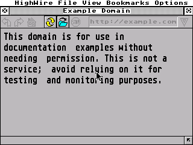

# HighWire on GEMbedded

The [HighWire](https://github.com/neilrackett/atarist-highwire) browser,
built for the RP2350 and running on pTOS. It renders local pages from the
card and it fetches over the network through pTOS' own STiK transport.



## What is where

| | |
| - | - |
| `GEM/highwire/` | the browser's source, GPL v3, kept here as content |
| `GEM/highwire-notes/` | this directory: everything that makes it build here. MIT |
| `GEM/highwire-libs/` | `build.sh` for zlib, libpng, libjpeg and giflib. Only the script is kept; it fetches the rest |
| `GEM/highwire-upstream/` | a git clone of Neil Rackett's repository, not in git. Where merges with him are done |

`GEM/highwire/` is content, not a clone or a submodule, because the clone
it came from is shallow: its history stops at 0.4.5 and the boundary
commit names a parent that was never fetched, which is not something to
push into a repository other people will clone. The upstream clone beside
it keeps the real history and the remote.

**Updating from upstream** happens in `GEM/highwire-upstream/`: fetch,
merge, build, and when it works copy the tree across (everything but
`.git`) and commit that here.

## Building

Three things in order. The first two are once; only the third is repeated.

```sh
# 1. the image libraries  (Git Bash on Windows, drive-letter paths)
cd GEM/highwire-libs && R="D:/Develop/GEMbedded" sh build.sh

# 2. libcmini, from inside its own directory so the paths stay relative
cd pTOS/lib/libcmini
make SHELL=/bin/bash BUILDDIR=../../obj/libcmini-build \
     ARCH_CFLAGS="-mcpu=cortex-m33 -mthumb -mfloat-abi=soft" \
     ARM_ABI_CFLAGS= libs startups

# 3. the browser
cd GEM/highwire-notes && R="D:/Develop/GEMbedded" sh build.sh
```

Out comes `out/HIGHWIRE.PRG` (about 633 KB) and `out/HIGHWIRE.RSC`. Send
both to a running machine, resource first so the program starts with it in
place:

```sh
python tools/gemdeploy.py GEM/highwire-notes/out/HIGHWIRE.RSC \
                          GEM/highwire-notes/out/HIGHWIRE.PRG
```

**It needs the PSRAM.** 633 KB cannot live in the 400-odd KB of ST-RAM
that is left after the framebuffer, so a machine whose
`CONF_RP2350_PSRAM_CS_PIN` is wrong answers "There is not enough memory in
your computer" and nothing else is wrong with it.

## The three files that are ours, and why

`gem-compat/` is the layer between HighWire's expectations and what this
machine has: the AES and VDI calls the board package does not carry, or
carries with another signature, plus the headers PureC supplies from its
own prelude and gcc does not. `gem-compat/gem.h` reaches the board
package's own header with `#include_next`, which is why its directory has
to come first on the include path.

`net/noovl.c` replaces HighWire's `src/ovl_sys.c`. On an Atari the network
is an overlay: a separate program loaded with `Pexec` that hands back a
function table, which is how HighWire chooses between STiK, STinG, MiNTnet
and MagiCNet at run time. Here the choice is made when it is built --
HighWire's own `src/inet.c` talks to the transport pTOS publishes under
the cookie `STiK` (`pTOS/include/stik.h`), the same code it would use on
an Atari with STinG. So nothing is ever loaded, and what is left of
`ovl_sys.c` is the bookkeeping the About box calls to list what is
loaded. It answers "nothing", which is true.

`hwstart.c` is one line: `_stksize = 128 KB`. HighWire's own Makefile asks
the Atari linker for the same number. Layout recurses once per nested
element, and the board package's accessory start-up would have given it a
fixed 4 KB.

`net/espnet.c` is **not** built. It is the AT-command network as it was
before it moved into the operating system; `GEM/examples/inettest` still
links it, and `pTOS/bios/machine/rp2350/rp2350_stik.c` is where it lives
now.

## What works, and what does not

Verified on a Waveshare RP2350-PiZero with the 2.8" ILI9341 and an ESP-01
on UART1, on 10 October 2026:

* starts, draws its toolbar and menu bar, and stays up
* renders local pages from the card
* **fetches over the network**: `http://example.com` returns 200 and is
  rendered, through `src/inet.c` to the `STiK` cookie to
  `rp2350_stik.c` to the ESP
* **and https, through a proxy.** With `HTTP_PROXY` set to a WebOne on
  the desk, `https://de.wikipedia.org/wiki/Atari_ST` is fetched and
  rendered. [`Proxy/README.md`](../../Proxy/README.md) is the setup.

  

Not there:

* **no TLS of its own**, so https needs that proxy. Without one, an
  https address ends in an error page naming the cause and the remedy
  rather than dialling cleartext at port 443. HighWire puts the whole
  absolute URI on the request line rather than opening a `CONNECT`
  tunnel, so the proxy has to be one that serves those -- WebOne calls
  it CERN-compatible and does both.
* one connection at a time, and no UDP. Both are limits of the AT module
  and both refuse honestly rather than hanging.
* the pointer is the touch panel. Keyboard shortcuts arrive over the USB
  console, but only as ASCII, so the ones that need Shift as well as
  Control (`Ctrl+Shift+O`, open a URL) cannot be sent that way. `Ctrl+Q`
  and the rest work.

## Our changes to HighWire itself

Seven, all in `GEM/highwire/src/`, all worth sending upstream and two of
them not ARM-specific at all:

| | |
| - | - |
| `encoding.c` | read UTF-16 units without breaking the aliasing rules. At `-O2` gcc deleted a store it was entitled to think dead, and the converter then dereferenced the stack |
| `defs.h` | lay out the `TEXTATTR` bit-fields the way the byte order demands. Written the big-endian way only, `.undrln` lands on the bottom bit of `.color` |
| `render.c` | accept HTML5's short `<meta charset>`, which carries no `http-equiv` and so never reached the test |
| `Loader.c` | say so when a redirect leads to https we cannot speak, instead of dialling cleartext at port 443 |
| `hwWind.c` | a held button is not yet a drag of the address field. A click holds for a tenth of a second, which made the field impossible to put a caret in |
| `raster.c` | the inline assembler is 68k, so the guard says `__mc68000__` and not merely `__GNUC__` |
| `inet.c` | `sockets_free` as a `short`, because `WORD` has no declaration that early in the file; and the gcc STiK branch needs `mint/mintbind.h` for the `Psignal` and `Talarm` it calls |

The last two lines are the ones to offer Neil first: neither has anything
to do with ARM.

## Licence

HighWire is GPL v3 or later and carries its own `LICENSE`. This directory
is MIT, but it is *combined* with HighWire at build time, so the program
that comes out, `HIGHWIRE.PRG`, is a combined work under the GPL v3.
[`docs/licensing.md`](../../docs/licensing.md) sets that out.

`PORT-ASSESSMENT.md` beside this file is the long version: every step of
the port and every wrong turn, including the one that cost a day.
