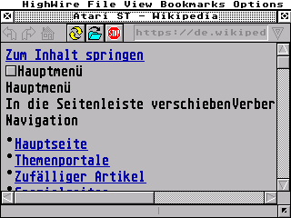

# The proxy, and why the browser needs one

HighWire has no TLS. It never did, and giving it some is not a weekend's
work: a TLS 1.3 handshake on a 150 MHz Cortex-M33 with 16 MB of PSRAM is
possible, but the certificate store, the clock it needs to check expiry
against, and the code size all come with it.

So the machine does what every other retro browser does: it asks a proxy
to do the encrypted part. That turns `https://` from "cannot" into
"slower", and the web the machine can reach goes from a remnant to
roughly all of it.

## What is here

[WebOne](https://github.com/atauenis/webone) by Alexander Tauenis, a
proxy built for exactly this — old browsers, new web. It terminates TLS,
and it can also down-convert pages, images and character sets for
machines that predate most of what a page assumes.

| | |
| - | - |
| `Webone_installed/` | the release build, as downloaded. Not in git |
| `Webone_repo/` | a clone of the source. Not in git |
| `webone.local.conf` | reserved for deviations from the shipped configuration. Nothing in it yet |
| `webone-run.log` | whatever the last run was redirected to. Not in git |

Neither of the first two is ours, and between them they weigh more than
everything else in this repository put together, which is why only this
file and the local configuration are kept.

The running program logs to `%AppData%\webone.log`, not to the file
beside it.

## Running it

```
Proxy\Webone_installed\webone.exe
```

It reads `webone.conf`, `codepage.conf` and `escargot.conf` from its own
directory, makes its own certificate authority from `ssl.crt` and
`ssl.key`, and says what it is doing:

```
Configured to http://<host>:8080/, HTTP 1.1, HTTPS 1.1, CERN-compatible
Listening for HTTP 1.x on port 8080.
```

**CERN-compatible is the part that matters.** HighWire does not open a
`CONNECT` tunnel; it puts the whole absolute URI on the request line, the
way a browser did in 1994. A proxy that only understands `CONNECT` is of
no use here. WebOne understands both.

It listens on `0.0.0.0`, so it is reachable from the machine over the
network without further ado — but a Windows firewall prompt on first run
is normal, and it has to be allowed for the private network.

## Pointing the machine at it

In `HIGHWIRE.CFG`, beside `HIGHWIRE.PRG` on the machine's `F:` drive:

```
HTTP_PROXY = 192.168.1.10 8080
```

Host and port, separated by a space or a colon. The address is the **PC's
address on your own network**, not `localhost` — the request comes from
the machine, not from the PC. On Windows, `ipconfig` names it; it is the
one on the interface that carries your LAN, and it is not the
`172.x` one that belongs to WSL.

Sending the file:

```sh
python tools/gemdeploy.py HIGHWIRE.CFG GEM/highwire-notes/out/HIGHWIRE.PRG
```

Configuration first and the program last, because `gemdeploy` starts
whichever file arrives last.

Without `HTTP_PROXY`, an `https://` address does not fail silently: it
ends in an error page that names the cause and this remedy. That is
`src/Loader.c:494` and `:977`, and both are ours.

## That it works

Verified 10 October 2026, with the machine at 192.168.178.88 and WebOne
on the PC:

```
>GET https://example.com/ (192.168.178.88)
 200 OK. Body of text/html; charset=utf-8 [Text].
<Done (connection close).
```

and then the real thing — `https://de.wikipedia.org/wiki/Atari_ST`,
fetched and rendered, which is a modern page on a machine whose operating
system is a reimplementation of one from 1985.



It is not fast. The AT module talks over a 115200 baud UART, one
connection at a time, and a Wikipedia article is a lot of bytes. The
status bar says `Receiving from ...` for a while and means it.

## What this does not solve

The proxy sees everything in clear. It is a machine on your own desk
serving a machine on your own desk, which is the only arrangement this is
meant for -- do not point the board at somebody else's open proxy and
then log in to anything.
